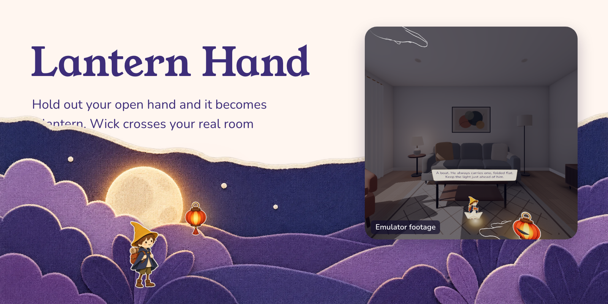
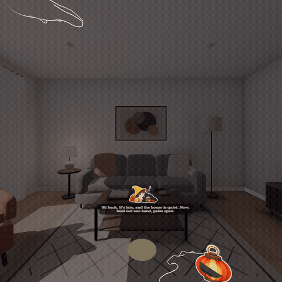
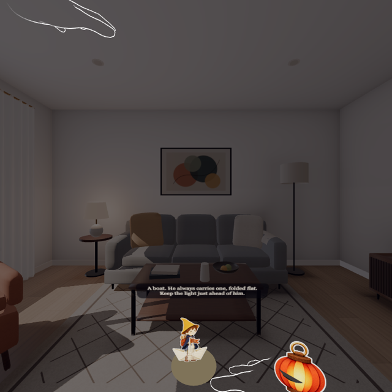
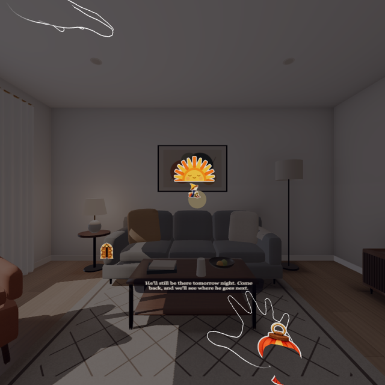
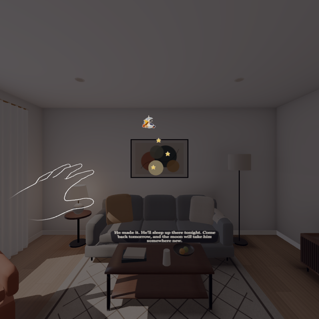

# Lantern Hand

Hold out your open hand and it becomes a paper lantern. A small paper traveller called Wick wakes on your real table and crosses your room toward your window (or, if it's behind you, the wall in front of you), walking only where you shine the light.

It needs a Meta Quest because the whole story is staged on your own furniture: the headset's scene understanding tells it where your table, couch, floor, door and window are, and hand tracking turns your palm into the light he follows. Every room gives a different journey, because the route is built from your room's own surfaces.

*Recorded in Meta's Immersive Web Emulator (Quest 3 profile, emulated living room), not on a headset.*

**Live:** https://lantern-hand.vercel.app (open it in the Meta Quest Browser on Quest 3 or 3S)

## Try it in 30 seconds

1. Sit down somewhere you can see your table or couch. Make sure your room is set up in the headset's Space Setup.
2. Open the link in the Quest Browser and press Enter. Put your controllers down.
3. Hold one hand out, palm open. When it lights up, point it at the small glow on your table, or knock twice on the table.

A chapter takes about six minutes. Wick stays where you left him: come back and chapter two starts on your windowsill. "Start again from chapter one" on the first page resets it.

| Chapter one: the boat crosses your floor | Sunrise (this room's window is behind the viewer, so the picture on the wall in front stands in) | Chapter two: three stars to the moon |
|---|---|---|
|  |  |  |

## How it uses the Meta platform

- **Scene understanding (WebXR plane detection):** every story beat is placed on a labelled surface from your room scan, kept in front of you and never hidden behind furniture, with a fallback for each missing label. No room scan at all gives a small paper stand-in room. [`app/src/room/stage.ts`](app/src/room/stage.ts)
- **Hand tracking (WebXR Hand Input):** an open palm lights the lantern and the direction your hand points casts the light, with a 14 degree aim assist because hand tracking is noisy. Two knocks on the real table wake him. No pinch is used, so the system menu gesture never fires by accident. [`app/src/story/hands.ts`](app/src/story/hands.ts)
- **Passthrough (immersive-ar):** night falls over your real room and lifts at dawn. [`app/src/story/story-system.ts`](app/src/story/story-system.ts)
- **Gaze:** with no hands in view, looking at the glow lights it, so the story can be played without hands.
- **Meta VR Glasses field of view:** captions and beats stay inside the design area; both chapters pass in the emulator's Meta VR Glasses profile.
- **Spatial audio:** footsteps, wind, water and the gate come from where they happen. [`app/src/story/sound.ts`](app/src/story/sound.ts)
- Built with Meta's Immersive Web SDK and tested in its emulator with emulated hands.

## Check it yourself

Evidence, stated plainly: no real users yet; it was built for this hackathon. Instead: our own break test of the room staging, including room scans it was never tuned on. It reruns from the repo with one command.

> Claim: Lantern Hand stages a full chapter in 401 of 401 test rooms: 8 emulator room scans with the viewer at fixed and random seats, heights and facings, stripped-down and partial copies of every scan, and the stand-in room.
> Evidence type: Our own break test (we tried to make it fail), not real users.
> Data: the eight room scans in Meta's Immersive Web Emulator plus 16 fixed and 240 random seats, stripped-down and partial copies, and the stand-in room: 401 cases (6 of the 8 scans were never used for tuning; 22 random seats facing a wall under 0.9 m away were out of scope). Baseline: our own naive fixed-offset staging, 0 of 401.
> Result: 401 of 401 (95% interval 99.1% to 100%). 1450 of 2005 placed beats sit within 35 degrees of straight ahead.
> Rerun: `npx -y tsx evidence/eval_staging.ts` (results in [`evidence/staging-results.md`](evidence/staging-results.md)). Limits: emulated scans, not real headsets; the degraded copies come from the same rooms; no frame-rate or comfort measure on a device.

Earlier runs failed (18 of 30 on the first run); what broke and what we fixed is listed in [`evidence/EVAL_PLAN.md`](evidence/EVAL_PLAN.md).

Walkthroughs of both chapters in the emulator, driven with emulated hands only: `cd app && python3 tests/walkthrough.py --knock` (hands and knock) and `python3 tests/walkthrough.py --gaze` (no hands at all). Every run is logged with its commit, emulated device (Quest 3 or Meta VR Glasses) and result in [`evidence/walkthroughs/runs.md`](evidence/walkthroughs/runs.md).

## What doesn't work yet

- Tested only in Meta's emulator, not yet on a physical headset, so frame rate and real-room behaviour are unverified.
- Two chapters; chapter three isn't written yet.
- The emulator rooms report labelled flat surfaces but no labelled furniture meshes, so staging uses flat surfaces only.

Art: paper cut-outs made with an AI image model. Narration, sound effects and music made with an AI voice and sound model.
